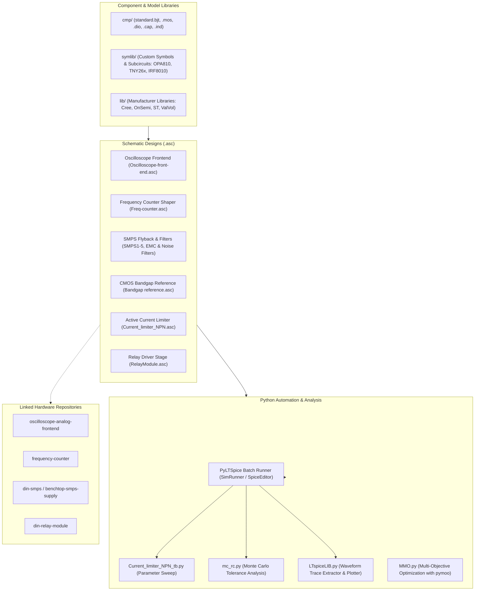

# LTspice Analog Circuits & Simulation Library

> Central repository of analog circuit schematics, custom SPICE device models, standard component databases, and Python automation testbenches for LTspice XVII / 24.x.

**Project Status:** `Active / Maintained` | **Primary Technologies:** `LTspice`, `Python 3`, `PyLTSpice`, `Matplotlib`, `NumPy`, `pymoo`

---

## 1. Purpose and Overview

This repository serves as the central engineering repository for analog circuit simulation, verification, and component modeling. It contains verified circuit schematics, parameterized testbenches, and thousands of SPICE models and symbols used across several hardware projects.

### Key Capabilities
- **Board-Level Hardware Simulation:** Direct simulation models for custom hardware modules, including the Oscilloscope Analog Frontend, Frequency Counter Input Shaper, Switch-Mode Power Supplies, and DIN-rail Relay Drivers.
- **Precision Analog Building Blocks:** CMOS bandgap voltage reference, active BJT current limiters/sources, and passive filter stages.
- **Automated Python Testbenches:** Scripted batch simulation execution, parameter sweeps, waveform extraction, and Monte Carlo tolerance analysis powered by `PyLTSpice`.
- **Analog Design Optimization:** Algorithmic parameter sizing problem formulation using multi-objective evolutionary algorithms (`pymoo`).
- **Unified Component Library:** Curated databases of active and passive components (`cmp/`), custom subcircuits (`symlib/`), and third-party manufacturer model libraries (`lib/`).

---

## 2. Architecture and Simulation Workflow

The simulation environment connects circuit design, component models, batch automation, and hardware project targets into a structured workflow:



---

## 3. Repository Structure

```text
.
├── cmp/                               # LTspice standard component databases
│   ├── standard.bjt                   # Extended BJT parameters (BC547, BD441, etc.)
│   ├── standard.cap                   # Electrolytic, ceramic, and film capacitor models
│   ├── standard.dio                   # Diodes, Zeners, Schottky models
│   ├── standard.ind                   # Power inductors, chokes, ferrite beads
│   ├── standard.jft                   # JFET models
│   └── standard.mos                   # MOSFET parameter models
├── lib/                               # Third-party and vendor SPICE libraries
│   ├── cmp/                           # Vendor component archives
│   ├── sub/                           # SPICE subcircuit model netlists (.sub, .lib, .cir)
│   └── sym/                           # Symbol collections (.asy)
│       ├── RCL-ELECTRO.RU/            # Audio and precision analog symbols
│       ├── ValVol/                    # Power electronics (Wolfspeed SiC, Infineon, ST)
│       ├── symbolsASM/                # Specialized logic and analog blocks
│       └── ZZZ/                       # Gate drivers, logic ICs (74HC series)
├── symlib/                            # Project-specific custom symbols and subcircuits
│   ├── 78L05.asy / .sub               # Linear regulator model
│   ├── BF2040.asc / .asy / .sub       # Dual-gate RF N-channel MOSFET
│   ├── irf8010pbf.asy / .spi          # 100V Power MOSFET subcircuit
│   ├── opa810_a.asy / .lib            # OPA810 rail-to-rail precision JFET opamp
│   ├── TNY263.asc / .asy              # TinySwitch-II offline switcher
│   └── TNY26x.asc / .asy              # TinySwitch-II family model
├── Bandgap reference.asc              # CMOS bandgap voltage reference schematic
├── Current limiter NPN.asc            # Two-transistor active current limiter schematic
├── Current_limiter_NPN.asc            # Parameterized version for automated sweeps
├── Current_limiter_NPN_tb.net         # Netlist testbench for BJT current limiter
├── Current_limiter_NPN_tb.py          # Python testbench: Rsense, Rc, load sweep & plotting
├── Freq-counter.asc                   # Fast comparator & input shaper for frequency counter
├── Oscilloscope-front-end.asc         # Dual-stage variable gain analog oscilloscope frontend
├── RelayModule.asc                    # Optocoupler + BJT relay driver simulation
├── SMPS.asc ... SMPS5.asc             # Switch-mode flyback converter design iterations
├── SMPS_EMCfilter.asc                 # AC line common-mode & differential EMC input filter
├── SMPS_Noisefilter.asc               # High-frequency switching noise suppression filter
├── SMPS_Stabilizer.asc                # Secondary-side post-filter and voltage stabilizer
├── ltspice-keyboard-shortcuts.pdf     # Quick reference card for LTspice keybindings
├── LTspiceLIB.py                      # Reusable trace extraction and matplotlib utility
├── mc_rc.py                           # Monte Carlo simulation script for RC filter cutoffs
├── MMO.py                             # Multi-objective optimization framework (pymoo)
├── print_lt.py                        # Introspection utility for PyLTSpice API classes
├── rc.asc / rc2.net                   # First-order RC filter test circuits
├── testsweep.py / test_rc.py          # Batch runner test scripts
├── .gitignore                         # Excludes gigabyte-scale .raw, .fft, and run logs
└── README.md                          # Project documentation
```

---

## 4. Key Schematics and Circuit Descriptions

### 4.1 Oscilloscope Analog Frontend (`Oscilloscope-front-end.asc`)
- **Frontend Buffer:** Low-capacitance JFET operational amplifier (`OPA810`) providing high input impedance (> 1 MΩ) with minimal loading.
- **Input Conditioning:** AC/DC coupling selection, input protection clamping diodes, and compensated frequency-flat attenuator network.
- **Variable Gain & Drivers:** Cascaded `AD8038` and `ADA4898` high-speed stages providing selectable amplification factors while maintaining high slew rate and low noise bandwidth.

### 4.2 Frequency Counter Conditioning (`Freq-counter.asc`)
- High-speed signal conditioning network that converts arbitrary periodic input waveforms (sine, triangle, distorted pulses) into clean CMOS-compatible square pulses.
- Includes AC coupling, DC offset bias, input protection clamping, and comparator hysteresis to prevent false triggering on noisy signals.

### 4.3 Switch-Mode Power Supplies (`SMPS*.asc`)
- Offline Flyback converters utilizing the Power Integrations `TNY263` / `TNY26x` TinySwitch-II IC.
- **EMC & Filtering:** Dedicated schematics for input differential/common-mode filters (`SMPS_EMCfilter.asc`) and output noise suppression LC filters (`SMPS_Noisefilter.asc`, `SMPS_Stabilizer.asc`).
- **Simulations:** Startup transient analysis, secondary flyback transformer coupling, and automated ripple measurement directives (`.meas tran RIPPLE`).

### 4.4 CMOS Bandgap Reference (`Bandgap reference.asc`)
- Combines a Proportional to Absolute Temperature (PTAT) current generated via ratioed diode-connected transistors with Complementary to Absolute Temperature (CTAT) forward-biased \(V_{BE}\) diode characteristics.
- Includes temperature sweep `.dc temp -40 125 5` to optimize component sizing (\(R_a, R_b, N_a=7, N_b=8\)) for near-zero temperature coefficient at room temperature.

### 4.5 Active BJT Current Limiter (`Current_limiter_NPN.asc`)
- Two-transistor constant current / current limiting topology using BC547B and power NPN BD441.
- Current threshold defined by \(I_{limit} \approx \frac{V_{BE(Q1)}}{R_{sense}}\).
- Parameterized in LTspice for automated load sweeps `.step dec param load 0.1 50 50`.

---

## 5. Python Automation and Requirements

The automated testbenches require Python 3 and the following dependencies:

```bash
pip install PyLTSpice matplotlib numpy pymoo
```

### Running Automated Testbenches

#### Parameter Sweep on Current Limiter
Executes LTspice headless, overrides netlist parameters (`Rsense`, `Rc`, load), and plots \(I_{out}\) vs. \(V_{out}\):
```bash
python Current_limiter_NPN_tb.py
```

#### Monte Carlo Analysis on RC Filter
Performs repeated simulations with component tolerances and calculates the statistical distribution of the \(-3\,\text{dB}\) cutoff frequency:
```bash
python mc_rc.py
```

#### Multi-Objective Circuit Optimization
Formulates the sizing of transistor parameters (\(W, L, I_{bias}, C_{comp}\)) as a multi-objective optimization problem (maximizing gain and unity-gain bandwidth while minimizing power consumption):
```bash
python MMO.py
```

---

## 6. Relations to Other Projects

This simulation library directly supports and feeds verified circuit blocks into the following hardware projects:

| Project | Repository / Directory | Linked Schematics |
| :--- | :--- | :--- |
| **Oscilloscope Analog Frontend** | `oscilloscope-analog-frontend` (PRJ-33) | `Oscilloscope-front-end.asc`, `symlib/opa810_a.*` |
| **Frequency Counter** | `frequency-counter` (PRJ-32) | `Freq-counter.asc` |
| **DIN-Rail SMPS Power Supply** | `din-smps` (PRJ-20, PRJ-21, PRJ-35) | `SMPS*.asc`, `SMPS_EMCfilter.asc`, `SMPS_Stabilizer.asc`, `TNY26x.*` |
| **Benchtop Power Supply** | `benchtop-smps-supply` (PRJ-34) | `SMPS*.asc`, `Current_limiter_NPN.asc` |
| **DIN-Rail Relay Module** | `din-relay-module` (PRJ-19) | `RelayModule.asc` |
| **PyLTSpice Automation Engine** | `PyLTSpice` (PRJ-38) | Driver engine used by all `*.py` scripts in this repository |

---

## 7. Known Limitations and Next Steps (TODO)

- [ ] **SPICE Model Paths:** Some legacy `.asc` files contain absolute path references (e.g. `C:\Users\josef\...`). Standardize all model inclusions to relative paths (`.include symlib/...` or `.lib lib/sub/...`).
- [ ] **Automated CI/CD Simulation:** Implement GitHub Actions runner with wine/LTspice CLI to automatically test critical netlists on commit.
- [ ] **Corner & Monte Carlo Expansion:** Expand `mc_rc.py` framework to run Monte Carlo analysis directly on the Oscilloscope frontend attenuator and SMPS feedback divider.
- [ ] **Packaging Custom Symbols:** Create an installation script to optionally symlink `cmp/` and `symlib/` into the user's local LTspice installation directory (`%LOCALAPPDATA%\LTspice\lib\`).
